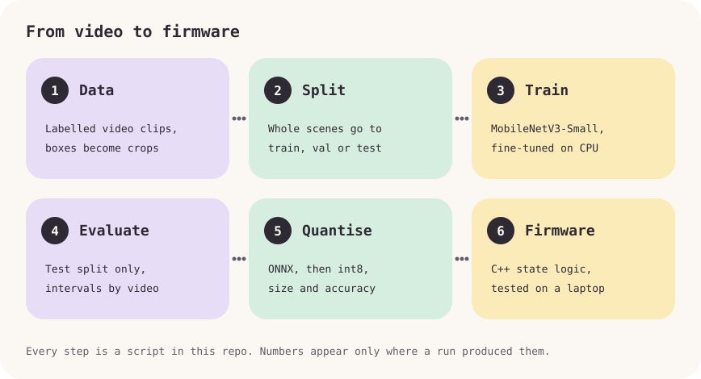
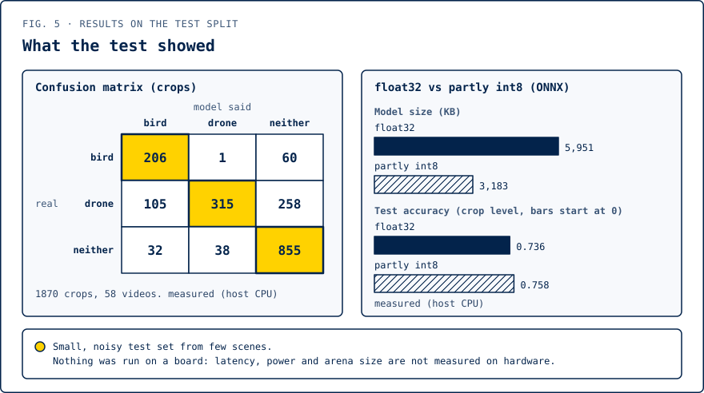
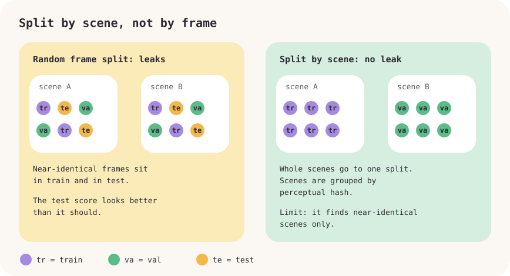
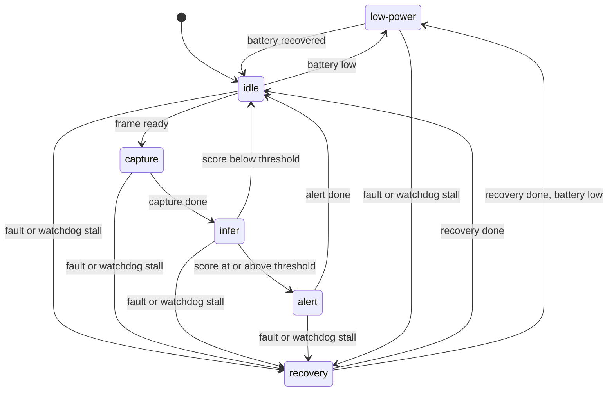
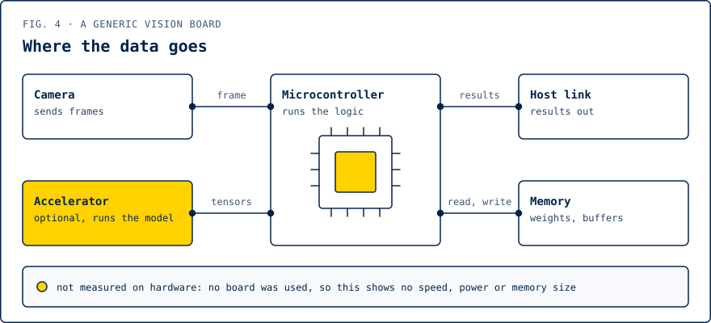

# edge-vision-lab

[](https://github.com/cesinata/edge-vision-lab/actions/workflows/ci.yml)

A small bird, drone and neither image classifier, trained on a laptop, quantised to int8, measured honestly, with its camera-node power logic tested on a laptop, written for people hiring in ML and edge AI and for learners new to edge AI.

**Live site:** https://cesinata.github.io/edge-vision-lab/ (this link works only after the first GitHub Pages deploy: Settings, Pages, Source: GitHub Actions; it has not been deployed yet). A walk-through of the pipeline with a webcam demo of a general detector, a board explainer, a memory-budget calculator and a state-machine viewer. The site's own copy is in `web/`.

<picture>
  <source media="(prefers-color-scheme: dark)" srcset="docs/img/pipeline-dark.svg">
  
</picture>

This is **image classification on crops**, not object detection: the model sees one cropped image and names its class. No microcontroller board was used. Everything about a board is a generic explanation, and any number about one is `not measured on hardware`.

## Results

Every number below is generated from a results file by `python scripts/make_readme_results.py`, and each carries the label saying how it was produced. The test set is small and comes from few scenes, so read the intervals, not just the point values.

<!-- results:start -->

**Test split, 1870 crops from 58 videos, measured (host CPU).** Crop-level accuracy 0.736. Intervals are 95%, resampled by video (2000 replicates). They treat videos as independent, which videos from one scene are not, so they are optimistic.

| Class | Crops | Precision | 95% interval | Recall | 95% interval | F1 |
| --- | --- | --- | --- | --- | --- | --- |
| bird | 267 | 0.601 | 0.38 to 0.77 | 0.771 | 0.66 to 0.87 | 0.675 |
| drone | 678 | 0.890 | 0.76 to 0.98 | 0.465 | 0.34 to 0.58 | 0.611 |
| neither | 925 | 0.729 | 0.66 to 0.80 | 0.924 | 0.88 to 0.97 | 0.815 |
| macro F1 |  |  |  |  |  | 0.700 (0.62 to 0.77) |

**Share of test crops classified into their own class, by subtype** (airplane, helicopter and background all count as "neither"; measured (host CPU)).

| Subtype | Videos | Crops | Correct | 95% interval |
| --- | --- | --- | --- | --- |
| bird | 12 | 267 | 0.771 | 0.66 to 0.87 |
| drone | 32 | 678 | 0.465 | 0.35 to 0.58 |
| background | 58 | 629 | 0.997 | 0.99 to 1.00 |
| airplane | 10 | 213 | 0.765 | 0.61 to 0.90 |
| helicopter | 4 | 83 | 0.783 | 0.61 to 0.95 |

**Bird alert threshold** on the test split (measured (host CPU)). Average precision for P(bird): 0.810 on test, 0.817 on validation.

| Rule | Threshold | Precision | 95% interval | Recall | 95% interval |
| --- | --- | --- | --- | --- | --- |
| P(bird) >= 0.5 | 0.500 | 0.618 | 0.40 to 0.79 | 0.768 | 0.65 to 0.87 |
| P(bird) >= 0.85 (firmware default) | 0.850 | 0.801 | 0.60 to 0.91 | 0.588 | 0.39 to 0.77 |
| chosen on validation for precision >= 0.90 | 0.994 | 0.979 | 0.90 to 1.00 | 0.352 | 0.16 to 0.54 |

**Size, accuracy and host-CPU latency** (measured (host CPU); CPU: Apple M3; ONNX Runtime 1.32.0, 1 thread, batch 1, median of 200 runs after 20 warm-up runs; KB = 1024 bytes). Reproduce with `python bench/run_bench.py`.

| Model | Size (KB) | Test accuracy | Test macro F1 | Bird recall | Median latency (ms) | p95 latency (ms) |
| --- | --- | --- | --- | --- | --- | --- |
| float32 ONNX | 5951 | 0.736 | 0.700 | 0.771 | 4.41 | 4.50 |
| int8 ONNX | 3183 | 0.758 | 0.704 | 0.753 | 3.99 | 4.13 |

Size ratio float32 / int8: 1.87 (measured (host CPU)). Activation memory lower bound from ONNX shape inference: 441.0 KB (estimated, onnx 1.23.2; a lower bound, not a tensor arena size). On a microcontroller: latency, frame rate, power and runtime arena size are **not measured on hardware**.

**Quantisation search** (measured (host CPU)): 18 int8 settings were tried and scored on the validation split only; chosen: `percentile/conv_gemm/float-se+depthwise`. Full table in `results/quantisation_search.json`.

**Training** (measured (host CPU)): 8 epochs, seed 0, 4736 train crops, 4492 s wall time on a laptop CPU (the machine named in the bench table), best epoch 4 by validation macro F1 0.7676.

**Firmware logic** (host build): 348 checks, 0 failures; line coverage of `guardian.cpp` 96.43% of 140 lines (measured (host CPU), llvm-cov gcov from Apple clang (Apple clang version 17.0.0 (clang-1700.6.3.2))).

**Split** (measured (host CPU), `train/make_split.py`): 235 videos in 99 scene clusters. Videos per split (clusters in brackets).

| Class | Train | Val | Test |
| --- | --- | --- | --- |
| bird | 29 (19) | 10 (9) | 12 (10) |
| drone | 66 (4) | 16 (2) | 32 (2) |
| airplane | 30 (26) | 7 (7) | 10 (9) |
| helicopter | 14 (8) | 5 (2) | 4 (3) |

<!-- results:end -->

<picture>
  <source media="(prefers-color-scheme: dark)" srcset="docs/img/results-dark.svg">
  
</picture>

## What I found

<!-- findings:start -->

1. **The model is good at calling background "neither" and weak at drones.** Test recall is 0.924 for neither, 0.771 for bird and 0.465 for drone. 258 of 678 drone crops were called neither and 105 were called bird, so bird precision is only 0.601. Almost all background crops are plain sky, which is easy (2 of 629 wrong).

2. **Distance matters.** Share of drone crops wrong: 15.8% close, 45.1% medium, 89.6% distant. Details and ten observations are in [docs/error-analysis.md](docs/error-analysis.md).

3. **High-precision bird alerts cost most of the recall.** At P(bird) >= 0.5: precision 0.618, recall 0.768. At the threshold 0.9936 chosen on validation for precision >= 0.90: precision 0.979, recall 0.352. The firmware's original default of 0.85 gives precision 0.801 and recall 0.588.

4. **The data limits what these numbers mean.** The 114 drone videos fall into only 8 scene clusters, the 51 bird videos into 38. The 32 drone test videos come from 2 scenes, with drone crops wrong 47.8% in one and 84.8% in the other (the second is mostly distant clips, so scene and distance are tangled). Training loss fell from 0.4415 to 0.0556 over 8 epochs while validation macro F1 stayed between 0.608 and 0.768, which fits a model that partly learns the place. I cannot show that it does, and this test set cannot rule it out.

5. **Plain int8 quantisation broke the model; a partial int8 model recovers most of it.** All 12 settings that quantised the convolutions together scored at most 0.531 validation macro F1 (float32: 0.7676). Leaving the depthwise and squeeze-and-excite convolutions in float32 recovered it to 0.732. On the test split that model has accuracy 0.758 against 0.736 for float32 (a difference within the noise of this test set), is 1.87 times smaller (3183 against 5951 KB) and runs 4.41 to 3.99 ms on this laptop CPU. Its bird alert is clearly worse: average precision 0.633 against 0.810, and at the threshold 0.8495 that it picked on validation for precision >= 0.90 it reached only precision 0.569 and recall 0.539 on test (`results/eval_onnx_int8.json`).

6. **The device logic is tested without a board.** 348 checks pass, including a watchdog stall, a fault in every state and battery hysteresis, and line coverage is 96.43%. Two deliberate breakages of the code were caught by the tests. This says nothing about real timing, interrupts or hardware.

<!-- findings:end -->

## Why the split is by scene

<picture>
  <source media="(prefers-color-scheme: dark)" srcset="docs/img/split-by-scene-dark.svg">
  
</picture>

Frames from one video look almost identical, so a random frame split leaks the same scene into training and testing. This project assigns whole scenes to one side.

## How to run

Tested on macOS (Apple M3). Python 3.12 is needed for the pinned versions. Training and the full pipeline are reproducible with the commands below; the code and tests need no dataset.

```bash
python3.12 -m venv .venv312 && source .venv312/bin/activate
pip install -r requirements.txt
python -m pytest -q train/tests

# device logic (C++17, no board SDK)
cmake -S firmware -B build && cmake --build build && ctest --test-dir build --output-on-failure
./build/guardian_cli firmware/traces/demo.csv      # replay a scripted trace
./build/guardian_cli --mermaid                     # print the state diagram

# website
bash scripts/fetch_web_assets.sh                   # third-party demo detector, size and SHA-256 checked
cd web && npm ci && npm run typecheck && npm test && npm run build && npm run dev
```

The full pipeline needs the public dataset (about 311 MB download) and, on a laptop CPU, roughly 75 minutes to train (`measured (host CPU)`, see the training line in the results). Nothing it produces is committed: videos, crops, split file and models stay in gitignored folders (`data/`, `models/`).

```bash
python train/download_data.py          # Zenodo, MD5 checked
python train/build_index.py            # labels, frame hashes, exclusions
python train/make_split.py             # split by scene cluster, seed 0
python train/make_crops.py             # crops, every 15th frame
python train/train.py                  # MobileNetV3-Small, 8 epochs, CPU
python train/evaluate.py --tag torch   # test split only
python export/export_onnx.py
python export/select_quantisation.py   # int8 settings scored on validation only
python train/evaluate.py --onnx models/model_fp32.onnx --tag onnx_fp32
python train/evaluate.py --onnx models/model_int8.onnx --tag onnx_int8
python bench/run_bench.py              # size, host-CPU latency, writes bench/results.json
python train/error_analysis.py --tag torch
python scripts/make_figures.py && python scripts/make_error_analysis_doc.py && python scripts/make_readme_results.py
bash scripts/preflight.sh              # checks before publishing
```

## Architecture

The device logic is a small C++ library (`firmware/src/guardian.*`) with no clock, no random numbers and no hardware calls; all time comes from a CSV trace. Every transition below lives in one table that the tests, this diagram and the website's diagram all read.



<picture>
  <source media="(prefers-color-scheme: dark)" srcset="docs/img/board-data-path-dark.svg">
  
</picture>

| Path | What it holds |
|---|---|
| `train/` | data download, label decoding, split, crops, training, evaluation, metrics, error analysis, tests |
| `export/` | ONNX export, int8 quantisation and the setting search |
| `bench/` | size, host-CPU latency, activation-memory estimate, `results.json` |
| `firmware/` | state and power logic, CLI, scripted traces, tests |
| `web/` | the learning site (Vite, TypeScript, React) |
| `scripts/` | figures, README tables, asset fetch, preflight |
| `docs/` | case study, decisions, data notes, sources, error analysis, lessons learned |

## What it does not do, and known limits

- It was **never run on a microcontroller board**. There is no on-device latency, frame rate, power or accelerator result, and no runtime tensor-arena figure. The activation-memory number is a lower bound from shape inference (`estimated`), not an arena size.
- It does not detect objects in a scene. It classifies a crop.
- The training footage is daylight only, within about 200 m, from one region, and the drone clips come from very few scenes. Results may not carry to other places. The scene-based split reduces leakage but only catches near-identical scenes.
- The test set is small (few scenes; 4 helicopter videos). Intervals are resampled by video and still treat videos from one scene as independent, so they are optimistic.
- The int8 model is **partly** int8: the depthwise and squeeze-and-excite convolutions stay in float32. Quantising everything lost most of the accuracy.
- There is no out-of-domain test set yet (planned from Open Images, not built).
- The project's own model is not published and the website says so. The demo uses a third-party detector (YOLOX-Nano, Apache-2.0) that this project did not train.
- CI and Pages workflows are written but have not been run.
- Earlier versions of this repository quoted a model size reduction taken from files that no longer exist; those figures were removed.

## Data and licence notes

Dataset: Svanstrom F., Alonso-Fernandez F., Englund C., *A dataset for multi-sensor drone detection*, Data in Brief 39 (2021) 107521, data on Zenodo (DOI 10.5281/zenodo.5500576), visible-light videos only. The authors recorded the footage except 49 airplane and helicopter clips marked in the dataset as taken from a YouTube channel; those are excluded. The dataset repository's `LICENSE` is CC0 1.0 Universal and the Zenodo record says "Other (Open)". **Written confirmation from the authors has been requested and not received**, so nothing derived from the videos (frames, crops, sample images, the split file, model weights) is published here. See `NOTICE`, `docs/data.md` and `docs/sources.md`.

Code and original text and drawings: MIT (`LICENSE`).

## AI disclosure

AI assistance (Claude) was used to draft and review code and text in this repository. I ran the experiments, and every number comes from a run in this repository; the commands that produce them are above and the raw outputs are in `results/` and `bench/`. Decisions, including what the AI got wrong and what I changed, are in `docs/decisions.md`.
